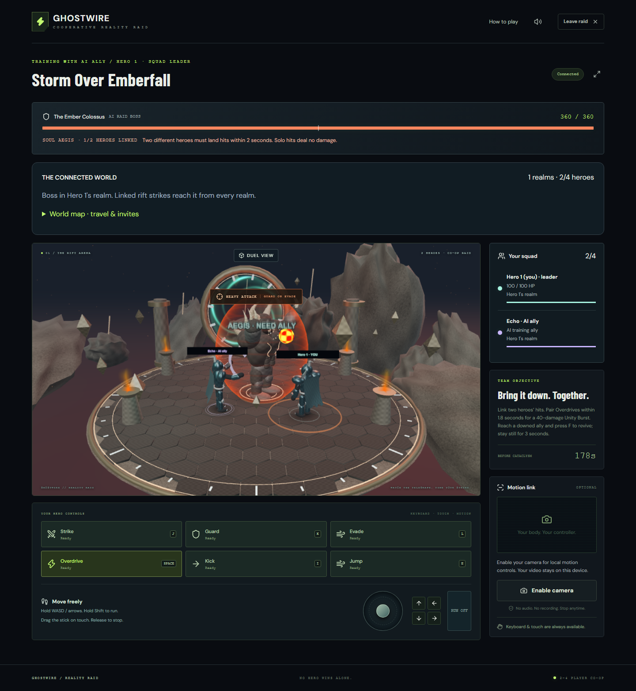
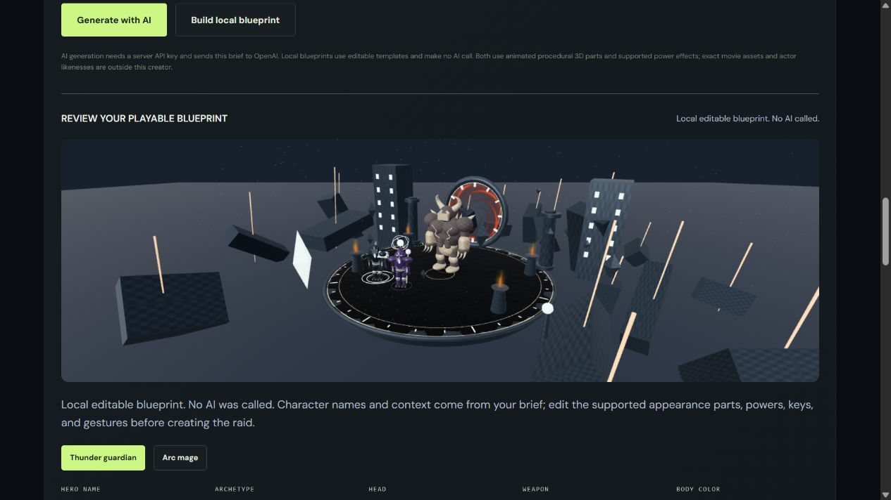

# GHOSTWIRE: COOPERATIVE REALITY RAID

**Your body is the controller. Your friends are your squad. No hero wins alone.**

A browser 3D raid for **2–4 heroes against one AI boss**. Everyone controls a hero. Coordinate attacks to break the boss's shield, combine powers, rescue teammates, and survive Reality Breach together.

**The world expands with your squad:** each device adds a connected realm. Travel between realms, follow boss invasions, or support allies with rift attacks. **Create a world** turns a movie/story/character brief into an editable 3D encounter, using `gpt-6.1-sol` or an explicitly labeled local blueprint. See [upgrade phases and supported generation](docs/EXPANDING_WORLDS.md).



[Cooperative design and phases](docs/COOPERATIVE_RAID.md) · [Exact controls](docs/CONTROLS.md) · [Phone walkthrough](docs/PHONE_TEST.md) · [Submission](SUBMISSION.md) · [Change log](CHANGELOG.md) · [AI assistance](AI_USAGE.md)

## Play locally

Requires Node.js 22.12+ and npm, with a WebGL 2 browser. No account or API key is needed for the three curated worlds.

```sh
npm ci
npm run setup:models
npm run build
npm start
```

Open **http://localhost:3001**. Create a raid, send the invitation to 1–3 teammates, and ready up. The squad leader begins when everyone is ready. A main raid cannot start with one hero. **Train with AI ally** provides Echo, a clearly labeled AI teammate, for rehearsal with the same cooperation rules.

Windows: **Start-Ghostwire.cmd** installs missing dependencies/models, builds, and starts the local game. Keep its window open. Development: `npm run dev` serves the frontend at localhost:5173 and proxies the server on port 3001. Stop the production server first if it occupies that port. Use `npm.cmd` when PowerShell policy blocks `npm.ps1`.

## How the team wins

- **Soul Aegis blocks all solo damage.** Two different standing heroes must land attacks within 2 seconds to break it. The team then gets a 6-second damage window.
- **Unity Burst:** pair two heroes' Overdrives within 1.8 seconds for 40 extra team damage. No friendly fire.
- **One shared boss, connected realms:** each device adds a region with personal movement, health, defenses and powers. Boss HP scales with squad size while preserving its percentage on late joins. Emberfall has 360 / 510 / 660 maximum HP for 2 / 3 / 4 heroes.
- **Travel and invasions:** watch/travel using the world map. Crossing takes 1.2 seconds standing still; gates recharge for 6 seconds. The boss announces invasions for 2.2 seconds. Its attacks affect only its current realm. Remote Strike is a weaker 4-damage rift bolt; Overdrive retains its power. Kick and revives require the same realm.
- **Read the boss:** it chooses threat targets, follows the squad, locks marked damage zones, and periodically marks every standing hero. Spread out or time a defense. Attack during recovery for bonus damage.
- **Rescue allies:** downed heroes have 20 seconds to be saved. Move close and press **F** or their **Revive** button; stay still for 3 seconds. Movement, damage, or another action interrupts. A revive restores 40% HP with brief protection.
- **Reality Breach:** at half scaled boss HP, every hero enters the camera-backed final phase. Each player's optional local video becomes their own backdrop; shared heroes and attack zones stay synchronized. No camera still gives a clearly labeled playable virtual fallback.
- **Team outcome:** defeat the boss for Mission Passed. A squad wipe, losing the team to departures, or the 180-second Cataclysm gives Mission Failed. Eliminated heroes spectate and share their team's result. The leader can request a fresh rematch.

## Controls

Presets use the controls below. Custom heroes show their power names/keys on buttons and exact gesture mappings in **Your power and motion guide**. All actions have touch buttons. See [the complete guide](docs/CONTROLS.md) or **How to play** for timings and hand-mode alternatives.

| Action      | Keyboard / touch                       | Body gesture                                                                  |
| ----------- | -------------------------------------- | ----------------------------------------------------------------------------- |
| Walk / run  | WASD or arrows; Shift / joystick + RUN | Lean left/right; step closer/farther. Greater calibrated shoulder width runs. |
| Strike      | J                                      | Quick arm extension, then neutral                                             |
| Kick        | I                                      | Lift a knee above its hip with hips/knees visible                             |
| Guard       | K                                      | Cross wrists near chest for ¼ second                                          |
| Evade       | L                                      | Small duck for ¼ second                                                       |
| Jump        | E                                      | One hand above head, other below shoulder, for ¼ second                       |
| Overdrive   | Space                                  | Both hands above head for ½ second                                            |
| Revive ally | F / their Revive button                | Use keyboard/touch; remain still for 3 seconds                                |

Camera capture requires an explicit click and HTTPS (or same-device localhost). Hold neutral for about 1.3 seconds to calibrate. One hand mode supports open-palm movement, swipe Strike, fist Guard, pinch Overdrive, and index-up Jump. Tracking loss stops movement; manual input stays available.

## Phones and hosting

Windows: double-click **Start-Phone-Test.cmd** or run `npm run phone:start` after building. Open the printed HTTPS address on laptop and phones. Create a squad on one device, scan the QR on each teammate's phone, and select **Join the squad**. **Stop-Phone-Test.cmd** / `npm run phone:stop` stops the temporary session. Runtime data stays in ignored `.local/phone-test/`. See [PHONE_TEST.md](docs/PHONE_TEST.md).

The temporary public link works while the laptop stays awake and online. A phone's localhost points to the phone itself. Plain LAN HTTP supports manual controls, while cameras need HTTPS. The server serves UI and Socket.IO together. For permanent hosting, use a long-running Node process behind HTTPS with WebSocket upgrades. Configure `PUBLIC_URL` for the canonical invite origin and `ALLOWED_ORIGINS` only for additional trusted frontends.

Run one server instance: rooms live in memory and restarts end raids. Disconnects pause the squad up to 30 seconds; private tokens resume heroes after graphics are ready. Timed-out heroes are removed; fewer than two teammates produces failure. Reinforcements may join during Arena/Reality while fewer than four total hero slots are used. Their device adds a realm and waits for its own graphics without pausing the fight.

A delayed reconnect reply preserves your hero and retries automatically. An explicit server rejection (such as an expired room) clears the saved session and shows the reason. Leaving cancels pending recovery.

Each device receives the complete world blueprint when creating, joining or resuming a room. Frequent battle updates carry live state and hero selection indexes, reusing that blueprint to reduce phone bandwidth. Stale updates can be skipped under backpressure; graphics readiness is retried until acknowledged.

Optional container recipe (not executed here):

```sh
docker build -t ghostwire .
docker run --rm -p 3001:3001 --env-file .env ghostwire
```

## Optional encounter director

Copy `.env.example` to `.env`, set server-only `OPENAI_API_KEY`, leave `OPENAI_MODEL=gpt-6.1-sol`, then restart. The API project needs model access. **Create a world → Generate with AI** uses Responses Structured Outputs with strict validation, a 75-second timeout and an 8,000-token output budget. Missing credentials/API failures show an error; choose **Build local blueprint** explicitly for no-key creation. Preview/edit heroes, boss, environment, powers, keys and recognized gestures, then create a lobby. Members choose their hero before readying up. Generated designs use procedural 3D parts and supported animations. [Creator details and limits](docs/EXPANDING_WORLDS.md).

Curated worlds bypass the API. The original simple story director retains its visibly labeled preset fallback. Keys stay on the server; requests use `store: false`. A real `gpt-6.1-sol` request has now succeeded in 45.8 seconds, producing Thor, Doctor Strange, Iron Man, Thanos and a rooftop environment. The exact output passes generated-power/gesture regressions and a complete three-client raid. The owner also confirmed hero rendering and gestures on one physical phone. See [the live AI verification record and exact controls](docs/LIVE_AI_VERIFICATION.md).

`npm run test:e2e:ai` replays the recorded real output without API charges. `npm run verify:ai -- --live --base http://localhost:3001` explicitly requests a new paid generation from a running configured server. `npm run verify:ai -- --help` makes no API call. To test an existing HTTPS demo, set `E2E_BASE_URL` before running the browser regression.

## Verification

```sh
npm run typecheck
npm test
npx playwright install chromium
npm run build
npm run test:e2e
```

The suite passes **134 rules/network/creator/motion tests in twelve files**, TypeScript and the production build. The earlier **11 browser scenarios passed in one combined run (7.7 minutes)**, covering complete matches, four-hero combat, camera breach, reconnect, outcomes, travel, expansion and the creator. On the final implementation, the generated three-client public HTTPS raid passed through victory/rematch in **2.2 minutes**, and three focused connection scenarios passed together in **2.0 minutes**, including two complete raids and lost graphics/resume messages. Current run details and the distinction between browser and physical-phone checks are in [the test plan](docs/TEST_PLAN.md) and [live AI verification](docs/LIVE_AI_VERIFICATION.md).

Live OpenAI generation is verified, and the owner reported rendering/gestures working on one phone. Broader physical body/hand recognition, multiple Android/iOS devices, venue networks and Docker remain separate checks. Synthetic camera/landmark tests establish integration. Existing versus-mode screenshots and [the earlier audit](docs/QA_AUDIT.md) are historical evidence; current verification is recorded separately.

## Privacy and boundaries

All camera video stays local in cooperative mode. No microphone, camera recording, face identification, or video storage. Stop camera terminates tracks; a team outcome automatically stops it too. Recap export contains only game text/stats. Reality Breach composites 3D meshes over video; it does not reconstruct rooms or occlude behind furniture. The boss uses authored animations and server AI. Accounts, matchmaking, persistent leaderboards, and production-scale anti-cheat are outside this release.

Original characters, terrain, textures, and effects are authored as Three.js geometry/shaders and SVG/CSS. Runtime/model/fonts retain their licenses in [THIRD_PARTY_NOTICES.md](docs/THIRD_PARTY_NOTICES.md). Event guidance remains in [RULES.md](RULES.md).

## Source map

- `apps/server/src/raidEngine.ts`: cooperative rules, AI boss, revives, and shared simulation.
- `apps/server/src/server.ts`: rooms, private hero ownership, APIs, readiness, reconnect, and snapshots.
- `apps/server/src/creativeDirector.ts`: bounded OpenAI creation and explicit local blueprints.
- `packages/shared/src/index.ts`: validated inputs, raid/hero contracts, and personal-view projection.
- `packages/shared/src/creative.ts`: hero/boss/environment schemas, supported effects and control validation.
- `apps/client/src/game/`: articulated 3D scene, team rigs, powers, materials, audio, and movement input.
- `apps/client/src/cv/`: local camera lifecycle and calibrated pose/hand controls.
- `apps/client/src/components/`: squad display, HUD, controls, Reality Breach, and outcomes.
- `tests/`: deterministic combat/raid checks, real Socket.IO sessions, and browser scenarios.

The earlier implementation plan and build log remain in `docs/` as historical context. [COOPERATIVE_RAID.md](docs/COOPERATIVE_RAID.md) describes the current game.


