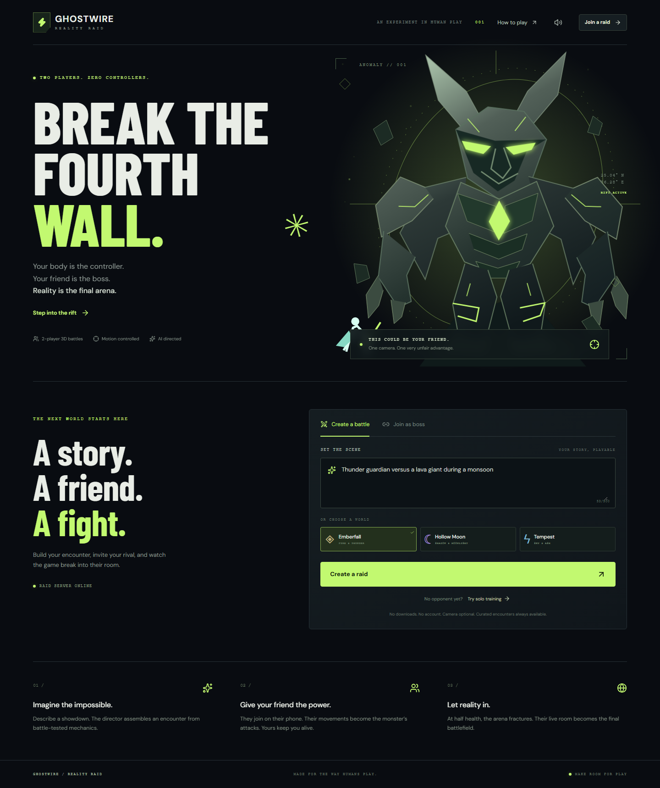

# GHOSTWIRE: REALITY RAID

**Your body is the controller. Your friend is the boss. Reality is the final arena.**

A browser-based, asymmetric two-player boss battle built for **Devin Hack Kochi**. One player controls the hero; a second player possesses the boss. At half boss health, the virtual arena fractures into the boss player's live camera feed. A server-authorized hand target becomes a combat zone over that feed.

**[Submission details](SUBMISSION.md)** · **[Change log](CHANGELOG.md)** · **[AI assistance](AI_USAGE.md)** · **[Event guidance](RULES.md)**



## Play locally

Requirements: Node.js 22.12+ (Node 24 LTS recommended) and npm. No API key is required to play.

```sh
npm ci
npm run setup:models
npm run build
npm start
```

Open **http://localhost:3001**. Choose **Try solo training** for an immediately playable match. Click **I'm ready**, then **Begin raid**. The three curated encounters work without AI credentials or camera permissions.

On Windows, after installing Node, you can also double-click **Start-Ghostwire.cmd**. It installs missing packages/models, refreshes the build, and starts the local server. Keep its window open while playing. When starting with `npm start` directly after editing source files, run `npm run build` first to refresh the production build.

For two people, choose **Create a raid**, open the invitation in another browser tab or device, and select **Possess the boss**. Both players mark themselves ready; the hero begins the raid. Each browser tab keeps its own private resume token in session storage.

Development: `npm run dev` serves the UI at **http://localhost:5173**, with API and Socket.IO requests proxied to port 3001. Stop the production server before starting development because both use port 3001. The root scripts work on Windows, macOS, and Linux; use `npm.cmd` if your PowerShell execution policy blocks `npm.ps1`.

## Controls

See [the exact controls, gestures, timings, and hand-mode alternatives](docs/CONTROLS.md). The same guide is available through **How to play** in the game. Touch supports a 360-degree joystick and all action buttons.

| Role                 | Keyboard / touch       | Body gesture                                                        |
| -------------------- | ---------------------- | ------------------------------------------------------------------- |
| Hero                 | J: Strike              | Extend one arm from neutral                                         |
| Hero                 | K: Guard               | Cross hands near upper chest                                        |
| Hero                 | L: Evade               | Lower shoulders slightly                                            |
| Hero                 | Space: Overdrive       | Hold both hands above the head for half a second                    |
| Hero                 | I: Kick                | Lift one knee above its hip, with hips and knees visible            |
| Hero                 | E: Jump                | Hold one hand high, with the other below shoulder level             |
| Both, arena          | Hold WASD / arrows     | Lean left/right; step closer to advance and farther away to retreat |
| Both, arena          | Hold Shift / touch RUN | Step closer until calibrated shoulder width grows about one third   |
| Boss                 | J: Swipe               | Extend one arm                                                      |
| Boss                 | K: Guard               | Cross hands near chest                                              |
| Boss                 | Space: Power           | Hold both hands above the head for half a second                     |
| Boss, hand-only mode | Swipe / Guard / Power  | Move open hand sideways / close fist / pinch thumb and index finger |

Camera controls are optional and require a deliberate click. Hold a neutral pose for calibration, keep the relevant joints visible, and use small comfortable movements. A confidence drop suppresses gesture input; manual controls remain available. The boss can aim by moving a tracked wrist/palm or by touching/moving a pointer over the arena.

The colored ring is a telegraph: damage resolves when its timer finishes. A target locks when the attack begins. Guard reduces damage; evade avoids damage during its brief active window. Attacking a boss during its wind-up deals reduced damage; striking during recovery deals bonus damage. A successful moon-shield special also grants a temporary guard.

## Implemented scope

- Cinematic responsive landing page, three curated worlds, editable story prompt, lobby and QR invitations.
- Solo training and real two-player combat with authoritative free movement, running, speed/boundary limits, melee reach, locked attack zones, jumps, kicks, guards, evasion, stats, victory, defeat, and rematch. Training bosses follow a distant hero.
- Pose and hand tracking using pinned local MediaPipe models/WASM, calibration, confidence filtering, smoothing, gesture cooldowns, camera errors, stop controls, and keyboard/touch fallbacks.
- Boss-to-hero WebRTC video with room-scoped signaling, camera restart, ICE configuration, generation IDs, stale-candidate protection, and retry controls.
- A real 3D arena with articulated armored fighters, perspective cameras, dynamic lighting, shadows, projectiles, and three themed worlds. Switch between Duel and Overlook views during arena combat.
- A 50% HP cinematic breach, transparent Three.js layer, miniature 3D hero, mirrored cover-coordinate mapping, targeted hits, and explicit no-live-camera fallback labels.
- Server-only OpenAI Responses API with Structured Outputs/Zod validation, bounded mechanics, 12-second timeout, refusal/error handling, and clearly identified curated fallbacks.
- Procedural animated character art, three backgrounds, telegraphs, particles, hit feedback, synthetic sound, mute, reduced motion, fullscreen, and PNG recap download.
- Original textured armor/stone, environment reflections, articulated limbs/cape, organic terrain, braziers, distinct elemental casts, and impact shockwaves. Slow/software renderers reduce detail; materials and powers preload before the opening countdown.
- Full-screen **MISSION PASSED / MISSION FAILED** outcomes for each role, with stats, replay, and recap export.
- Thirty-second disconnect pause and token-based resume, private role ownership, room expiry, request limits, input validation, and bounded queues.

The phase-by-phase analysis is in [IMPLEMENTATION_PLAN.md](docs/IMPLEMENTATION_PLAN.md); implementation evidence and remaining checks are in [IMPLEMENTATION_LOG.md](docs/IMPLEMENTATION_LOG.md) and [TEST_PLAN.md](docs/TEST_PLAN.md).

## Optional AI director

Copy `.env.example` to `.env`. Set `OPENAI_API_KEY` and, optionally, `OPENAI_MODEL` to a Structured Outputs-capable model available to your account. The example uses `gpt-4o-mini`; this is a configurable choice, not a guarantee of account availability. Restart the server.

Edit the story text to request a new AI encounter. Clicking a world preset intentionally bypasses the API. No key, refusal, timeout, invalid schema, or API failure leads to a safe, visibly labeled preset. Keys are server-only; never place them in a `VITE_*` variable. Model output can select only supported mechanics and colors; it cannot supply executable code, asset URLs, or external actions. Requests use `store: false`.

## Phones, HTTPS, and deployment

For a ready-to-use Windows phone test, double-click **Start-Phone-Test.cmd**, then use the printed HTTPS URL on both devices. **Stop-Phone-Test.cmd** shuts it down. See [the phone walkthrough](docs/PHONE_TEST.md) for camera calibration, joining, and the Reality Breach check. The regular localhost game stays separate.

A phone opening `http://localhost` connects to itself, not your laptop. A phone on a LAN can use your laptop's address for **manual controls**, but camera capture requires **HTTPS** (or the same-device localhost exception).

For camera play, deploy this app as one long-running Node process behind HTTPS, or expose port 3001 through a trusted HTTPS tunnel. Open that HTTPS address on the host too; invitation URLs follow the host's browser origin. Alternatively, set `PUBLIC_URL` to the HTTPS URL before starting. Set `ALLOWED_ORIGINS` only for additional trusted frontends.

The built server serves both the UI and Socket.IO on port 3001. It is not a static-only deployment or a serverless function. Forward WebSocket upgrades and keep the Node process alive. Run one instance: rooms live in memory and a restart ends active raids. Horizontal scaling requires shared room state and a compatible Socket.IO adapter.

Optional container (configuration supplied at runtime):

```sh
docker build -t ghostwire .
docker run --rm -p 3001:3001 --env-file .env ghostwire
```

STUN is included. Restrictive networks may require a TURN server; configure `TURN_URL`, `TURN_USERNAME`, and `TURN_CREDENTIAL`. Use short-lived TURN credentials for a public deployment. If media fails, the game continues in an explicitly labeled virtual arena. Signaling carries no camera frames.

## Privacy

Hero video stays local. The boss's enabled camera is transmitted peer-to-peer to the hero in the same room. No microphone capture, face identification, camera recording, or video storage is performed. Stop camera terminates tracks and clears the remote feed. Recap export contains game text/stats only. Demo recording is a separate, deliberate participant-consent step.

## Verification

The independent post-build audit, tested fixes, exact verification results and
remaining real-device checks are in [QA_AUDIT.md](docs/QA_AUDIT.md).

```sh
npm run typecheck
npm test
npx playwright install chromium
npm run build
npm run test:e2e
```

Unit/integration tests exercise real Socket.IO sessions, combat, schemas, coordinate transforms, gesture fixtures, and AI success/failure branches. Browser tests exercise actual UI controls, both outcomes, two independent players, camera denial, synthetic live WebRTC, real-target damage, reload recovery, recap export, mobile layouts, and rematch.

The free-movement/motion upgrade passed **46 unit/network checks and all 10 browser scenarios**, including two complete two-player matches, free walking/running, jump/kick, animated Overdrive, live-video breach, both outcomes, rematch, and graphics recovery. Strict TypeScript and the production build also passed. Public HTTPS assets, invitations, shared combat, and media signaling were separately verified. See [the implementation record](docs/IMPLEMENTATION_LOG.md) for the current scope; the independent audit records an earlier milestone.

Browser camera evidence uses Chromium's **synthetic camera**, not a person or a prerecorded demonstration. It establishes that media transport/compositing works locally; it does not establish real-body gesture accuracy or phone-network connectivity. Real lighting/device testing and a consenting two-person demo recording remain required before a hackathon submission. A live OpenAI response has not been verified without an API key. The Docker recipe is provided but not executed in this environment.

## Architecture and source map

```text
apps/client/src/
  components/       Home/lobby/game UI, camera panel, controls, result card
  cv/               Camera lifecycle, pose/hand tracking, gesture rules
  game/             Three.js arena, fighter rigs, projection, effects and sound
  networking/       Socket sessions, resume and WebRTC video
  styles/           Responsive visual system
apps/server/src/
  combatEngine.ts   Deterministic combat and state transitions
  server.ts         Room ownership, snapshots, signaling and HTTP
  battleDirector.ts Bounded structured generation and offline fallback
packages/shared/src/ Shared Zod contracts, registries, types, camera mapping
tests/              Unit, real-network integration, and Playwright tests
docs/               Phases, QA evidence, demo guide and screenshots
```

React renders the interface; Three.js renders actual mesh characters and environments through a perspective camera. Rigid geometry is batched, floor tiles are instanced, pixel density is capped for phones, and slow devices automatically reduce rendering detail. WebGL 2 is required; unavailable or interrupted graphics display an actionable message. Clients submit intents, not damage or health. The server ticks at 20 Hz and broadcasts authoritative snapshots. The simulation clock freezes on disconnect, preserving remaining telegraphs/cooldowns. Both remote video and target mapping use mirrored `object-fit: cover` geometry. Arena fighter positions come from the server; the miniature Reality Breach hero is unprojected onto a camera-facing plane; Reality Breach warning circles retain the exact screen-space damage radius. Boss attack targets are fixed at acceptance, so movement after wind-up cannot retroactively move a damage zone.

## Boundaries

The game uses real 3D models and arenas with free arena movement and combat. Reality Breach composites the miniature 3D hero over live camera video; it does not reconstruct the room or provide furniture occlusion. The monster uses authored action animations rather than retargeting every body joint. Gesture thresholds need physical rehearsal. Accounts, persistent leaderboards, matchmaking, custom gesture training, narration, and production-scale anti-cheat are outside this release. No real-person demonstration recording is implied by the local build.

Original character/background art is authored as SVG, CSS, and Three.js mesh geometry and shaders. Fonts and runtime/model assets retain their respective licenses; see [THIRD_PARTY_NOTICES.md](docs/THIRD_PARTY_NOTICES.md).

## Official implementation references

- [OpenAI Structured Outputs](https://developers.openai.com/api/docs/guides/structured-outputs)
- [MediaPipe Pose Landmarker for Web](https://ai.google.dev/edge/mediapipe/solutions/vision/pose_landmarker/web_js)
- [MediaPipe Hand Landmarker for Web](https://ai.google.dev/edge/mediapipe/solutions/vision/hand_landmarker/web_js)
- [Socket.IO rooms](https://socket.io/docs/v4/rooms/)
- [Three.js WebGL renderer](https://threejs.org/docs/pages/WebGLRenderer.html)
- [MDN WebRTC negotiation](https://developer.mozilla.org/en-US/docs/Web/API/WebRTC_API/Perfect_negotiation)
