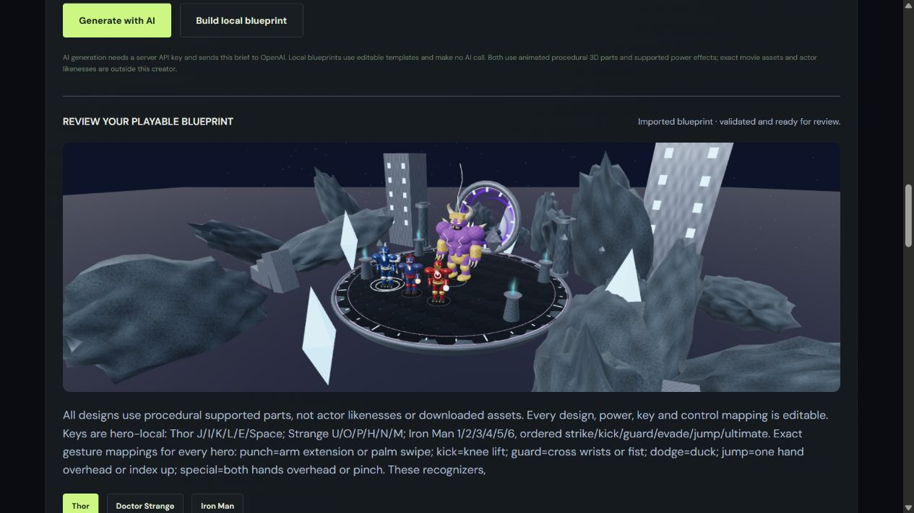

# Live AI encounter verification — 25 October 2026

## Actual generation

One real request to the application's `/api/forge` used the owner's private server key and **`gpt-6.1-sol`**. It completed successfully in **45.8 seconds**, at **05:01:39 +05:30**. The server returned source `ai` after strict schema and gameplay validation; no template fallback was used.

The public test brief requested an Avengers-inspired cooperative rooftop fight. The unmodified generated design is preserved in [the regression fixture](../tests/fixtures/ai-avengers.json), with model, timestamp, elapsed time and brief. It includes no key, authorization header, participant data or live room credential. Subsequent tests replay this exact output through the ordinary editor/import/save flow, avoiding another paid request. Imported designs are labeled as imports rather than local generation.

| Hero           | Strike / Kick / Guard / Evade / Jump / Overdrive keys | Generated ultimate                                              |
| -------------- | ----------------------------------------------------- | --------------------------------------------------------------- |
| Thor           | J / I / K / L / E / Space                             | Call the Lightning · thunder strike · 38 damage · 8.5s recharge |
| Doctor Strange | U / O / P / H / N / M                                 | Moon-Shield Convergence · moon shield · 22 damage · 8s recharge |
| Iron Man       | 1 / 2 / 3 / 4 / 5 / 6                                 | Repulsor Overcharge · fire orb · 35 damage · 8s recharge        |

The six physical recognizers map to Strike / Kick / Guard / Evade / Jump / Overdrive respectively: arm extension or palm swipe; knee lift; crossed wrists or fist; duck; one hand overhead or index up; both hands overhead or pinch. One-hand mode uses touch for knee/duck actions. WASD/arrows move, Shift runs and F revives a nearby teammate in the same realm. The on-screen guide shows each hero's actual mapping.

**Boss:** Thanos, with a purple/gold colossus appearance and two distinct supported attacks: Power Gauntlet: Falling Sun (fire orb, 18 damage, 1.4s warning), and Reality Breach (shadow wave, 24 damage, 1.8s warning). **Environment:** Fractured Manhattan Rooftop, with generated palette, metal ground, rain and eight towers/ruins/crystals outside the playable circle. These are procedural parts and supported mechanics, without actor likenesses or imported movie meshes.



## Verified behavior

- All **134 unit/network/creator/motion tests in twelve files** pass, including applying each generated hero's six power definitions to authoritative combat, recognizing every generated gesture mapping from synthetic landmarks, compact-update round trips and negotiating snapshot compression when supported.
- The exact design completed a **three-client browser raid**: two heroes ready/start, generated keyboard mappings and a touch strike, region travel, late Iron Man reinforcement, scaled boss HP, all three ultimate effects, both named boss warnings, camera-backed Reality Breach, a shared victory and fresh rematch readiness. No server state or outcome was forced.
- The local full-match run passed in two minutes with zero browser errors. Every generated hero dealt real team damage: Thor 191, Doctor Strange 206 and Iron Man 132 in that run. Actual inputs and authoritative snapshots produced these values; later runs can differ.
- The owner reported that **Doctor Strange rendered and gestures worked on one physical phone**. An initial physical attempt ended while the laptop hero was idle; zero solo damage is expected under Soul Aegis. This report confirms that phone's rendering/recognition, not an independently observed full physical-device match.
- The **final public HTTPS three-client replay passed cleanly in 2.2 minutes**, including all of the above and zero browser errors. Thor dealt 151 damage, Doctor Strange 265 and Iron Man 100; health scaling preserves the boss's remaining fraction when Iron Man joins, so damage totals need not equal the final scaled maximum. The result screenshot was captured at **05:59:32 +05:30**, followed by verified rematch readiness at **05:59:36 +05:30**. This exercised implementation `7a827086b7e6c3f7fccc5aa110f06ef235bb6719` through the actual temporary phone service, including the final recovery and phone-label fixes.
- Three final connection regressions also passed together in **2.0 minutes** on that implementation: two complete human-role raids with camera breach/reconnect/rematch, a deliberately lost graphics confirmation and a deliberately lost resume message. The earlier 11-scenario combined suite and this focused final run are separate checks.

The first public replay exposed a graphics-readiness wait. The client now retries its first-frame confirmation until the server acknowledges it. Later testing exposed delayed updates when repeating the generated blueprint and every hero's powers at 20Hz. The complete blueprint now arrives on create/join/resume; replaceable live snapshots carry hero selection indexes and reconstruct the same state on each device. The public two-hero probe shrank from **13,454 bytes to 2,901 bytes per snapshot** (about 78% smaller), with a 288ms graphics confirmation and Arena reached normally in that measured run. Tests preserve every live field, selected profile, duplicate display names and standard presets. These are observed samples, not latency guarantees.

WebSocket compression is negotiated where supported. Cloudflare's current public edge did not advertise it; the direct-server negotiation is verified separately. The compact protocol works without compression. No schema, damage rule or outcome was weakened to pass the replay.

A later public victory exposed a reconnect edge case during rematch. A transient resume timeout previously cleared the saved hero like an explicit server rejection. The client now preserves the identity, pauses controls while recovering and retries; leaving/room closure invalidates stale attempts. The server still decides expiry and identity validity. A browser regression deliberately drops the first real resume message, including the polling-before-WebSocket path, and confirms the same hero/lobby/readiness returns without another slot. It passed in 10.3 seconds.

The initial browser exercises were corrected to keep heroes moving during inspection, use each hero's generated keys, and travel before remote rescues. Those are test-driving changes, without weakening boss rules or forcing success. Contrasting cape colors now use the secondary costume palette. Narrow phone controls use two columns and wrap long power names while preserving the key labels. Synthetic camera/landmarks do not establish every physical device, lighting condition or browser.

## Repeat the checks

The regression replay uses the saved real output and makes **no paid generation call**:

```sh
npm test
npm run build
npm run test:e2e:ai
```

To exercise an already running HTTPS demo, set `E2E_BASE_URL` to the URL printed by `npm run phone:status`, then run `npm run test:e2e:ai`. The test leaves the source encounter unchanged, uses real application inputs and closes its synthetic rooms afterward.

Run browser commands one at a time. Overlapping Playwright processes can delete each other's default report artifacts. An initial successful public battle hit that report-saving error; the isolated rerun above passed. Use `--output=test-results/public-ai` for a separate report directory when needed.

Generated-run screenshots are saved inside that run's report folder. Copy its `live-ai-*.png` files into `docs/screenshots/` after checking the successful result, rather than overwriting files being reviewed during a run. An intermittent Windows screenshot-file error prompted this separation. Successful evidence is written only after victory and rematch checks pass.

A fresh paid API request is explicitly opt-in. Start/restart the server after changing `.env`; the model must remain `gpt-6.1-sol`:

```sh
npm run verify:ai -- --help
npm run verify:ai -- --live --base http://localhost:3001
```

The second command sends the fixture brief once and saves its result to ignored `.local/live-ai/latest.json`. The key stays on the server. Default tests do not consume API credits. The official [model documentation](https://developers.openai.com/api/docs/models/gpt-6.1-sol) describes the requested API model; only the actual successful request establishes access for this project at the recorded time.
